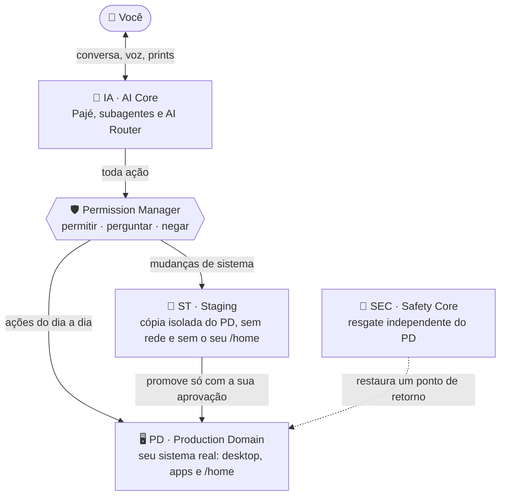
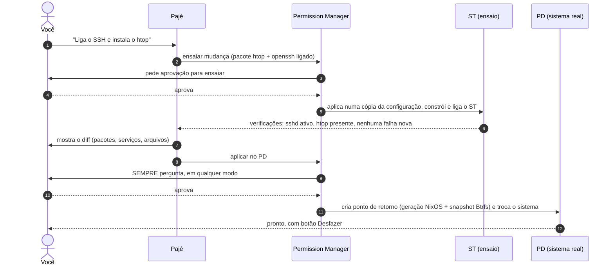
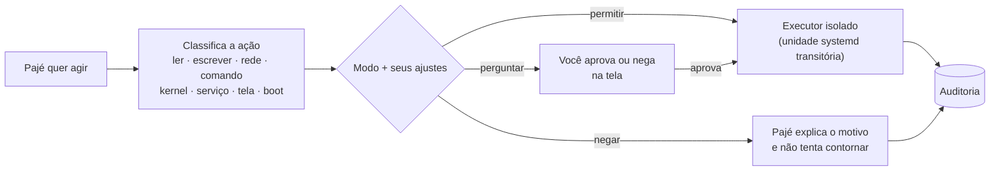
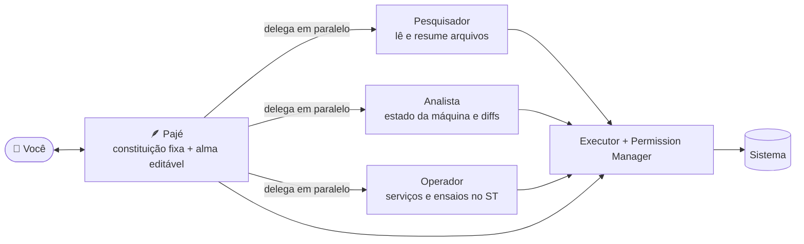
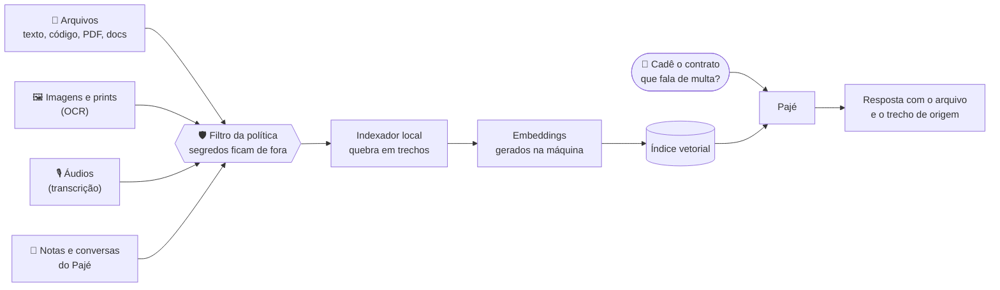

<div align="center">

# E se uma IA tivesse acesso a tudo na sua máquina?

### Mas tudo mesmo. Inclusive o kernel.

**TUPIOS** é um sistema operacional feito para responder essa pergunta sem medo.

[](LICENSE)


</div>

---

Hoje, assistentes de IA moram dentro de uma janela. Eles conversam, explicam e sugerem comandos, mas
quem executa é você, copiando e colando. Do sistema operacional em si, eles não alcançam quase nada:

| Função do sistema | Por que a IA normalmente fica de fora | No TUPIOS |
|---|---|---|
| **Kernel**: parâmetros `sysctl` (memória, swap, rede, escalonador) | Exige root, e um valor errado trava a máquina | O Pajé muda na hora, guarda o valor anterior e oferece **Desfazer** |
| **Boot**: parâmetros do kernel, módulos e drivers | Um erro aqui e o computador não liga | Ensaiado antes, aplicado com ponto de retorno, e o SEC resgata se não bootar |
| **Serviços do sistema** (`systemd`) | Exige root, e parar o serviço errado derruba a sessão | Consultar, ligar, parar e reiniciar. Serviços críticos ficam protegidos |
| **Programas do sistema** | O gerenciador de pacotes exige root | Instalados pela configuração NixOS, ensaiados antes de chegar ao sistema real |
| **Configuração do sistema inteiro** (firewall, SSH, rede, energia…) | Fica espalhada em `/etc`, sem como voltar atrás | Qualquer opção do NixOS, com diff antes e rollback depois |
| **Tela, mouse e teclado** | A IA não sai da própria janela | Vê a tela, clica, arrasta e digita. Você retoma o controle mexendo o mouse |
| **Processos, CPU, memória e disco** | Fora da sandbox do app | O Pajé lê o estado da máquina antes de propor qualquer mudança |
| **Pontos de retorno do sistema** | A maioria dos SOs nem tem | Geração NixOS + snapshot Btrfs antes de cada mudança |

```
       ASSISTENTE DE IA COMUM                     PAJÉ, A IA DO TUPIOS

  ┌──────────────────────────────┐          ┌──────────────────────────────┐
  │ apps e janela do chat        │◄── IA    │ apps e janela do chat        │◄──┐
  ├──────────────────────────────┤          ├──────────────────────────────┤   │
  │ arquivos e terminal          │          │ arquivos e terminal          │◄──┤
  ├──────────────────────────────┤          ├──────────────────────────────┤   │
  │ tela, mouse e teclado        │          │ tela, mouse e teclado        │◄──┤
  ├──────────────────────────────┤          ├──────────────────────────────┤   │
  │ serviços (systemd)           │          │ serviços (systemd)           │◄──┼── Pajé
  ├──────────────────────────────┤          ├──────────────────────────────┤   │
  │ programas e configuração     │          │ programas e configuração     │◄──┤
  ├──────────────────────────────┤          ├──────────────────────────────┤   │
  │ boot, drivers e módulos      │          │ boot, drivers e módulos      │◄──┤
  ├──────────────────────────────┤          ├──────────────────────────────┤   │
  │ kernel (sysctl)              │          │ kernel (sysctl)              │◄──┘
  └──────────────────────────────┘          └──────────────────────────────┘

  A IA comum enxerga a própria janela.       O Pajé alcança todas as camadas,
  Do resto, sabe o que você copia e cola.    sempre passando pelo Permission Manager.
```

## Então por que ninguém faz isso?

Porque, com acesso a tudo, um único erro pode deixar o computador sem bootar. Um `rm -rf` no lugar
errado, um parâmetro do kernel que esgota a memória, o serviço de rede desligado no meio de uma
atualização.

O TUPIOS parte de outra pergunta: **e se errar não fosse um desastre?**

O problema nunca foi dar acesso à IA. Foi não ter onde **ensaiar** antes, não ter **quem aprove** no
meio do caminho e não ter **como voltar** depois. O TUPIOS resolve as três coisas no próprio sistema
operacional, e não num app instalado por cima dele.

## A proposta: quatro núcleos

O TUPIOS é construído sobre o NixOS, em que o sistema inteiro é descrito em arquivos de configuração.
Assim, toda mudança vira um **diff** que dá para ensaiar, revisar e desfazer. Em volta disso, o sistema
é dividido em quatro núcleos:



| Núcleo | Papel |
|---|---|
| **PD** · Production Domain | O sistema real, onde você trabalha. A IA nunca muda o sistema do PD direto: mudanças de sistema passam antes pelo ST |
| **ST** · Staging | Um container com a mesma configuração do PD, sem rede e sem a sua pasta pessoal. A IA testa ali e mostra o resultado |
| **IA** · AI Core | O Pajé, os subagentes e o AI Router, que fala com o provedor que você escolher (OpenAI, Anthropic, Gemini, Groq, OpenRouter, DeepSeek, Ollama local ou qualquer API compatível com OpenAI) |
| **SEC** · Safety Core | Um sistema de resgate separado, que volta gerações e snapshots anteriores mesmo com o PD quebrado, sem tocar no seu `/home` |

## Uma mudança de verdade, do pedido ao Desfazer

Exemplo: você pede *"liga o SSH e instala o htop"*.



Parâmetros do kernel são um caso à parte: o ST usa o **mesmo kernel** do PD, então não dá para
ensaiá-los no container. O Pajé avisa isso e oferece aplicar na hora, de forma temporária (vale até
reiniciar, com Desfazer), e depois tornar permanente pela configuração, com ponto de retorno.

## Quem decide o que a IA pode fazer: você

Toda ação do Pajé, de ler um arquivo a mudar um parâmetro do kernel, passa pelo **Permission Manager**
antes de acontecer. Ele classifica a ação, aplica o modo que você escolheu e registra tudo num log de
auditoria encadeado por hash, que a IA não consegue alterar.



| Modo | A IA faz sozinha | Pergunta antes | Negado |
|---|---|---|---|
| **restrito** (padrão) | Ler arquivos e informações | Escrever no `/home`, acessar a rede, rodar comandos, ensaiar mudanças de sistema no ST | Mexer direto no sistema real (serviços, kernel, pacotes, boot, hardware, root): aqui, mudança de sistema só passa pelo ST |
| **perguntar** | Nada | Quase tudo | Bootloader, acesso cru a disco/hardware, root, apagar arquivos do sistema, ler segredos |
| **livre** (por 1 h, até reiniciar ou sempre) | Quase tudo | Ações destrutivas, aplicar no PD, usar a tela | Ler segredos |

E há regras que **nenhum modo muda**:

- A IA nunca altera a própria política de permissões, o executor nem o log de auditoria.
- Aplicar uma mudança no sistema real **sempre** pede aprovação, mostrando o diff.
- Usar mouse e teclado **sempre** pede aprovação. Mexeu no mouse, o controle volta para você.
- Comandos destrutivos (`rm -rf`, parâmetros perigosos do kernel…) pedem confirmação extra, até no modo livre.
- Segredos (chaves SSH, senhas do navegador, a chave da API) só com um ajuste explícito seu.
- O botão **PARAR IA** cancela todos os trabalhos em poucos segundos.

## O Pajé e a equipe dele

O **Pajé** é a IA com quem você conversa: numa janela própria, num chat rápido ou numa bolinha
flutuante sempre visível. Ele aceita texto, fotos, PDFs, prints e voz (transcrita localmente, então o
áudio não sai da máquina).

Para trabalhos maiores, o Pajé monta uma equipe de **subagentes**. Cada um tem uma *alma* (um arquivo
`.soul.md` editável com personalidade, método, ferramentas e orçamento diário de tokens) e pode usar um
modelo diferente: um subagente num modelo local, outro num modelo de nuvem.



A alma descreve **como** o agente trabalha, mas não dá permissão a nada. Subagentes não criam outros
agentes, não delegam e nunca aplicam mudanças no PD: só o Pajé pode pedir isso, e só com a sua
aprovação. Referência completa em [apps/tupi-agent/HARNESS.md](apps/tupi-agent/HARNESS.md).

## Três princípios inegociáveis

1. **A IA é opcional.** O sistema funciona sem ela. Se a IA estiver offline, o PD opera normalmente.
2. **O sistema real é sagrado.** Nenhuma ação da IA compromete o PD direto. Mudanças de sistema passam
   pelo ST e pela sua aprovação.
3. **Tudo tem volta.** Toda mudança tem ponto de retorno testável, e voltar o sistema nunca apaga os seus
   dados.

## Próximos passos

O que já está pronto aparece marcado. O resto é para onde o TUPIOS está indo. Quer ajudar? Escolha um
item, abra uma issue ou mande um PR: todo PR passa pela revisão do mantenedor antes de entrar.

### 🧠 Second brain do Pajé

Hoje o Pajé lembra do seu perfil e dos seus hábitos. A ideia é ele virar uma segunda memória sua: lembrar
do que você decidiu, do que você estava fazendo e de onde as coisas estão.

- [x] Memória de perfil e hábitos (SQLite, Memory Engine)
- [x] Modo proativo: o Pajé observa, resume e sugere (nada é executado sem passar pela política)
- [ ] Notas que o Pajé guarda e liga sozinho: decisões, preferências, pessoas, projetos
- [ ] Notas em Markdown numa pasta sua, legíveis em qualquer editor
- [ ] Captura rápida pela bolinha: *"Pajé, anota isso"* por texto, voz ou print
- [ ] Histórico do que mudou no sistema e por quê, ligado à auditoria e aos pontos de retorno
- [ ] Resumo diário e semanal: o que você fez, o que ficou pendente, lembretes
- [ ] Você vê, edita e apaga qualquer memória (*"esquece isso"*), e tudo fica na sua máquina

### 🔎 Encontrar arquivos pelo conteúdo (RAG e vetorização)

Você não deveria precisar lembrar o nome do arquivo. Basta perguntar *"cadê o contrato que fala de multa
por atraso?"*.



- [ ] Indexador local que lê o conteúdo de texto, código, PDF, documentos do Office, imagens e prints (OCR) e áudios (transcrição)
- [ ] Embeddings gerados na própria máquina, para que o conteúdo dos arquivos não saia do computador
- [ ] Índice vetorial local (ex.: `sqlite-vec` ou LanceDB) atualizado sozinho quando um arquivo muda
- [ ] Ferramenta `buscar_arquivos` para o Pajé e para os subagentes
- [ ] Busca híbrida: significado + nome, data, tipo e pasta
- [ ] Respeita a política: o que a IA não pode ler (como `~/.ssh` e senhas) nunca entra no índice
- [ ] Toda resposta cita o arquivo e o trecho de onde a informação veio

### 🎙️ Comando de voz

- [x] Gravar áudio no app e transcrever localmente (whisper.cpp)
- [ ] Palavra de ativação (*"Ei, Pajé"*) sem abrir o app, processada na própria máquina
- [ ] Conversa contínua, mãos livres, que você pode interromper
- [ ] Respostas faladas com síntese de voz local (ex.: Piper)
- [ ] Aprovar ou negar pedidos por voz, com confirmação extra para ações de risco
- [ ] Indicador sempre visível quando o microfone estiver ouvindo, e um botão para mutar na hora

### 📱 Acesso pelo celular

- [ ] App (ou PWA) para conversar com o Pajé de qualquer lugar
- [ ] Pareamento por QR code e conexão criptografada direto com a sua máquina (ex.: WireGuard), sem abrir portas
- [ ] Notificação de pedidos de aprovação, com aprovar e negar pelo celular
- [ ] **PARAR IA** pelo celular
- [ ] Ver o estado da máquina e acompanhar a tela ao vivo quando o Pajé estiver usando o computador
- [ ] Mandar foto, áudio ou arquivo do celular direto para o Pajé

### 💡 Outras ideias

- [ ] **Ensaiar o kernel numa microVM**: hoje o ST divide o kernel com o PD e não consegue testar `sysctl` nem parâmetros de boot
- [ ] **Atualizações ensaiadas**: o Pajé atualiza o sistema no ST, testa e mostra o diff antes de você aplicar
- [ ] **Diagnóstico automático**: o Pajé lê os logs (`journalctl`, `dmesg`), acha a causa de uma falha e propõe a correção
- [ ] **Perfis da máquina** (bateria, desempenho, silencioso, jogo) que ajustam kernel, CPU e serviços de uma vez
- [ ] **Backup do `/home`** configurado pelo Pajé, com teste de restauração de verdade
- [ ] **Linha do tempo da auditoria** no app, com verificação da cadeia de hash
- [ ] **Modo 100% offline**, com modelo local como padrão
- [ ] **Conectores MCP** (agenda, e-mail, Git…) passando pelo Permission Manager como qualquer outra ação
- [ ] **Biblioteca de almas**: compartilhar e importar subagentes prontos
- [ ] **Acessibilidade**: usar o computador inteiro só com a voz, para quem não usa mouse e teclado

### 🧱 Base do sistema

- [ ] Testes em hardware real (notebooks e desktops variados)
- [ ] Desktop nativo do TUPIOS (Rust + Smithay) no lugar do desktop de transição

---

## Estrutura do projeto

```
tupios/
├── flake.nix                  # Configurações: tupi-pd, tupi-st, tupi-ia, tupi-sec, tupi-iso
├── justfile                   # Comandos de desenvolvimento
├── nixos/
│   ├── pd/                    # PD: sistema real do usuário
│   ├── st/                    # ST: container de ensaio
│   ├── ia/                    # IA: AI Router, orquestrador e memória
│   ├── sec/                   # SEC: sistema de resgate
│   ├── iso/                   # ISO instalável
│   └── modules/               # Permission Manager, agente, assistente, ST, desktop, instalador…
├── apps/
│   ├── tupi-agent/            # Pajé: executor, política de permissões, subagentes, CLIs
│   ├── tupi-assistant/        # App do Pajé: janela, chat rápido e bolinha flutuante
│   ├── agent-orchestrator/    # Orquestrador de agentes + memória (MCP)
│   └── control-center/        # Control Center (Tauri + SvelteKit)
├── installer/                 # Módulo do instalador Calamares
├── scripts/                   # Scripts de build e utilitários
├── tests/                     # Testes (vm, security, e2e)
└── docs/                      # Documentação
```

## Desenvolvimento

### Pré-requisitos

- Nix com flakes habilitado
- QEMU/KVM
- ~20 GB livres para os builds

### Primeira vez

```bash
cd tupios
nix develop          # entra no dev shell
just check           # valida que tudo compila
just vm-pd-bios      # sobe o PD numa VM
```

### Comandos

```bash
just check           # valida o flake
just build-pd        # constrói o sistema do PD (sem ativar)
just vm-pd           # sobe o PD numa VM (UEFI)
just vm-pd-bios      # sobe o PD numa VM (BIOS, mais simples)
just clean           # limpa caches e artefatos
nix build .#tupi-iso # gera a ISO instalável
```

## Documentação

| Documento | Conteúdo |
|---|---|
| [docs/ARCHITECTURE.md](docs/ARCHITECTURE.md) | Especificação técnica dos quatro núcleos e dos módulos |
| [docs/INSTALLATION.md](docs/INSTALLATION.md) | Instalação, atualização e recuperação |
| [docs/HARDWARE.md](docs/HARDWARE.md) | Compatibilidade de hardware |
| [apps/tupi-agent/HARNESS.md](apps/tupi-agent/HARNESS.md) | Pajé, subagentes, almas, conexões de IA, CLI `paje` e API local |

## Status

**0.1.0-alpha.** Projeto em desenvolvimento ativo: use em VM ou numa máquina de testes.

## Licença

Distribuído sob a [licença MIT](LICENSE). Use, modifique e redistribua à vontade, mantendo o aviso de
copyright.

---

<div align="center">

*TUPIOS: a IA com acesso a tudo, e você no controle de tudo.*

</div>
