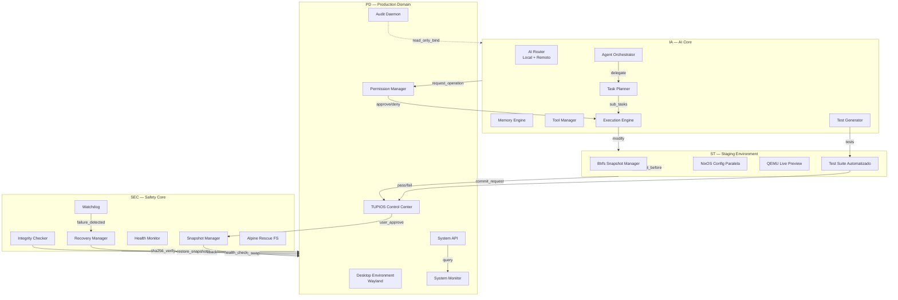
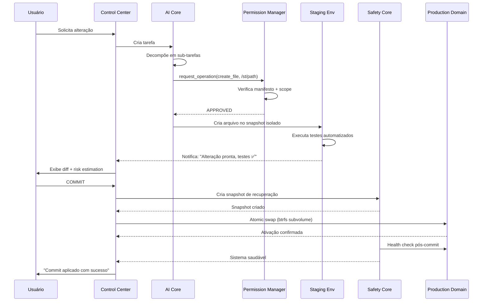
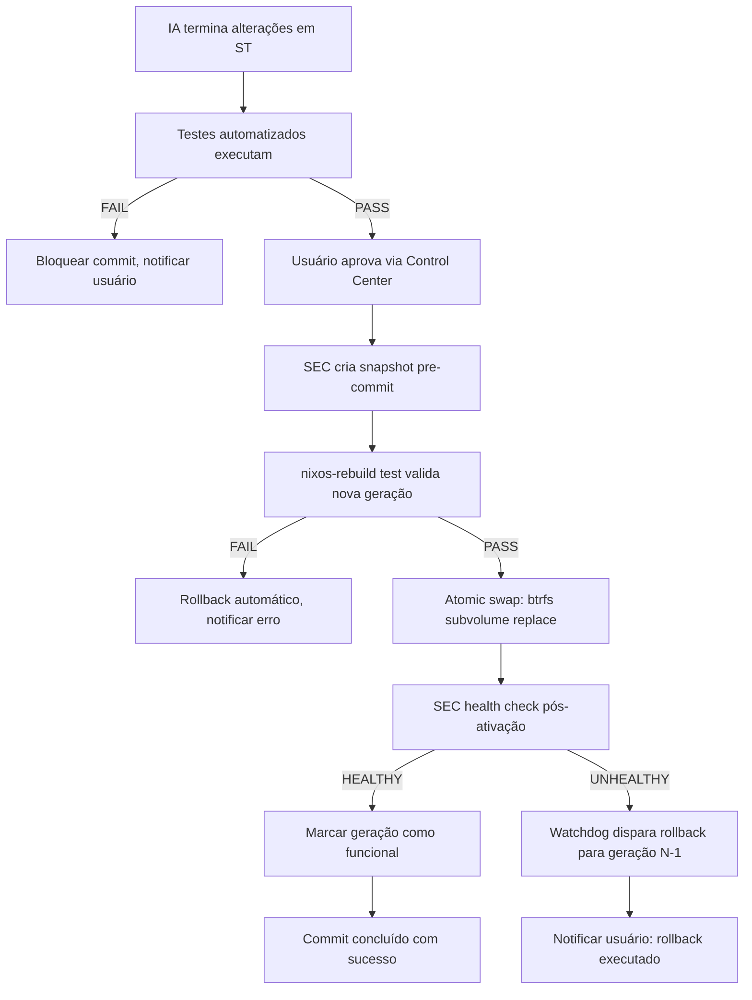

# TUPIOS — Architecture Specification v1.0

> **Status**: Entregável 1 — Validação de Arquitetura  
> **Base**: NixOS 26.05 + Flakes | Btrfs + LUKS | Wayland | Ollama  
> **Princípios**: AI Independence · Production Integrity · Recoverability

---

## 1. Visão Geral dos 4 Núcleos



---

## 2. Comunicação Entre Núcleos

### 2.1 Protocolos IPC

| Canal | Protocolo | Direção | Latência | Uso |
|-------|-----------|---------|----------|-----|
| IA ↔ Permission Manager | Unix Socket (SOCK_STREAM) | Bidirecional | <1ms | Request/approval de operações |
| IA ↔ System API | D-Bus Session Bus | IA → PD | <2ms | Consultas read-only (status, processos) |
| ST ↔ PD (Live Preview) | QEMU/KVM virtio-gpu | ST → PD | ~16ms | Renderização remota do desktop ST |
| SEC ↔ PD | Unix Socket + shared memory | Bidirecional | <1ms | Health checks, snapshot triggers |
| Audit Daemon ↔ IA | Bind mount read-only | PD → IA | N/A | Logs imutáveis via filesystem |
| Agent Orchestrator ↔ Agents | Message Queue (ZeroMQ PUB/SUB) | Orchestrator → Agents | <1ms | Distribuição de sub-tarefas |
| Memory Engine ↔ Agents | Shared memory (mmap) | Bidirecional | <0.1ms | Contexto compartilhado entre sessões |

### 2.2 APIs Síncronas vs Assíncronas

- **Síncronas**: Permission Manager approval (bloqueia agente até decisão), System API queries (resposta imediata)
- **Assíncronas**: Commit requests (fila com callback), Agent task distribution (pub/sub), Health monitoring (polling periódico)
- **Message Queue**: ZeroMQ para orquestração de agentes; persistência em `/var/lib/tupi-ia/mq/` para recovery pós-crash

### 2.3 Diagrama de Sequência: Operação da IA



---

## 3. Isolamento

### 3.1 Namespaces Linux

| Namespace | PD | ST | IA | SEC |
|-----------|----|----|----|-----|
| **PID** | Host | Isolado (nspawn) | Isolado (nspawn) | Isolado (init próprio) |
| **Network** | Host | Isolado (veth pair) | Restrito (egress only) | Nenhum (offline) |
| **Mount** | Host | Overlay + bind mounts | Restrictivo | Read-only rootfs |
| **UTS** | Host | Hostname próprio | Hostname próprio | "tupi-rescue" |
| **IPC** | Host | Isolado | Isolado | Isolado |
| **User** | Root + user | Mapeado (subuid) | Mapeado (subuid) | Root only |
| **Cgroup** | Slice system | Slice tupi-st | Slice tupi-ia | Slice tupi-sec |

### 3.2 AppArmor Profiles

```apparmor
# /etc/apparmor.d/tupi-ia-container
#include <tunables/global>

profile tupi-ia flags=(attach_disconnected,mediate_deleted) {
  #include <abstractions/base>
  #include <abstractions/nameservice>
  
  # Filesystem: apenas /var/lib/tupi-st/** e /tmp/tupi-ia/**
  /var/lib/tupi-st/** rw,
  /tmp/tupi-ia/** rw,
  /nix/store/** r,
  
  # Bloquear acesso a PD, SEC, kernel
  /home/** deny,
  /etc/shadow deny,
  /proc/sys/** deny,
  /sys/** deny,
  /dev/mem deny,
  /dev/kmem deny,
  
  # Network: apenas API endpoints configurados
  network tcp,
  unix (create, connect, send, receive),
  
  # Capabilities: nenhuma privilegiada
  capability dac_override deny,
  capability sys_admin deny,
  capability net_admin deny,
}
```

### 3.3 Seccomp Filters

Perfil restritivo para container IA (allowlist):
- `read`, `write`, `open`, `close`, `stat`, `fstat`, `lstat`, `poll`, `mmap`, `mprotect`, `munmap`, `brk`, `ioctl`, `access`, `pipe`, `select`, `sched_yield`, `dup`, `dup2`, `clone`, `fork`, `vfork`, `execve`, `exit`, `wait4`, `kill`, `uname`, `fcntl`, `flock`, `fsync`, `getcwd`, `chdir`, `rename`, `mkdir`, `rmdir`, `link`, `unlink`, `chmod`, `chown`, `getpid`, `getuid`, `getgid`, `socket`, `connect`, `sendto`, `recvfrom`, `bind`, `listen`, `accept`, `getsockname`, `getpeername`, `setsockopt`, `getsockopt`, `epoll_create`, `epoll_ctl`, `epoll_wait`, `clock_gettime`, `nanosleep`, `getrandom`

Bloqueados explicitamente: `mount`, `umount`, `pivot_root`, `swapon`, `swapoff`, `reboot`, `settimeofday`, `adjtimex`, `init_module`, `finit_module`, `delete_module`, `kexec_load`, `perf_event_open`, `ptrace`, `process_vm_readv`, `process_vm_writev`.

### 3.4 Filesystem Boundaries

```
/                           # PD root (Btrfs subvolume @pd-root)
├── /home                   # Dados do usuário (subvolume @home, separado)
├── /var/lib/tupi-st/       # ST workspace (subvolume @st-workspace)
│   └── snapshots/          # Snapshots Btrfs do ST
├── /var/lib/tupi-ia/       # IA data (models, memory, mq)
├── /var/lib/tupi-sec/      # SEC metadata (generations.json, checksums)
├── /var/log/tupi-audit/    # Audit logs (append-only, bind mount r/o para IA)
├── /nix/store              # Compartilhado PD/ST (deduplicação nativa)
└── /efi/tupi-rescue/       # SEC rescue partition (FAT32, independente)
```

Bind mounts para IA container:
- `/var/log/tupi-audit/` → `/var/log/tupi-audit/` (read-only)
- `/nix/store` → `/nix/store` (read-only)
- `/var/lib/tupi-st/workspace` → `/workspace` (read-write, scoped)

---

## 4. Permissões

### 4.1 Capability-Based Security Model

Cada operação da IA é avaliada contra um **manifesto declarativo** (`manifest.json`) que define scopes permitidos:

```json
{
  "skill": "file-manager",
  "version": "1.0.0",
  "scopes": {
    "filesystem": {
      "read": ["/var/lib/tupi-st/**", "/nix/store/**"],
      "write": ["/var/lib/tupi-st/workspace/**"],
      "deny": ["/home/**", "/etc/**", "/var/lib/tupi-sec/**"]
    },
    "network": {
      "egress": ["https://api.openai.com/**", "http://localhost:11434/**"],
      "ingress": []
    },
    "syscalls": {
      "allow": ["read", "write", "open", "close", "mkdir", "rename"],
      "deny": ["mount", "ptrace", "reboot"]
    },
    "resources": {
      "cpu_quota": "50%",
      "memory_limit": "2G",
      "pids_max": 64
    }
  },
  "approval_required": false
}
```

### 4.2 Approval Workflow

| Categoria | Exemplo | Aprovação |
|-----------|---------|-----------|
| **Whitelist (Skill)** | `create_folder`, `read_file`, `list_processes` | Automática |
| **Approval First-Use (Plugin)** | `install_package("docker")`, `modify_config("network")` | Prompt no Control Center (primeira vez) |
| **Always Approve (Mod)** | Kernel params, firmware, overclock, hardware direto | Sempre requer aprovação explícita |
| **Hard Deny** | `set_cpu_frequency`, `write(/proc/sys/*)`, `access(/dev/mem)` | Bloqueado permanentemente |

### 4.3 Privilege Escalation Paths

- IA **nunca** tem root direto. Todas operações passam pelo Permission Manager.
- Operações aprovadas são executadas por um **Execution Engine** com capabilities elevadas temporárias (via `capsh`).
- Pós-execução, capabilities são revogadas imediatamente.
- Audit log registra: timestamp, skill/plugin/mod, operação, alvo, decisão, executor PID.

### 4.4 Audit Trail

Formato append-only em `/var/log/tupi-audit/audit.jsonl`:
```json
{"ts":"2026-11-06T14:23:01Z","src":"ia-core","skill":"file-manager","op":"create_folder","target":"/var/lib/tupi-st/workspace/new-app","decision":"APPROVED","executor_pid":4821,"checksum":"sha256:a1b2c3..."}
```

Proteções:
- Filesystem: `chattr +a` (append-only) no arquivo de log
- Mount: bind mount read-only para container IA
- Rotação: logrotate com compressão, retenção 90 dias
- Integridade: checksum SHA256 de cada linha armazenado em `/var/lib/tupi-sec/audit-chain.hash`

---

## 5. Armazenamento

### 5.1 Layout Btrfs Subvolumes

```
/dev/mapper/tupi-root (LUKS)
└── Btrfs filesystem
    ├── @pd-root          # PD system root (snapshottable)
    ├── @home             # User data (NUNCA snapshotted com sistema)
    ├── @st-workspace     # ST working area
    ├── @st-snapshots     # ST snapshot storage
    ├── @nix-store        # Shared Nix store (dedup nativa)
    ├── @var-lib-tupi     # /var/lib/tupi-{ia,sec,audit}
    └── @swap             # Swapfile (se necessário)
```

### 5.2 LUKS Encryption

- Root partition: AES-XTS-PLAIN64, 512-bit key
- Header backup em `/efi/tupi-rescue/luks-header.img` (partição SEC)
- Key derivation: Argon2id, 4 threads, 64MB memory
- Passphrase + optional FIDO2 token support

### 5.3 Snapshot Lifecycle

| Tipo | Retenção | Frequência | Trigger |
|------|----------|------------|---------|
| Pre-commit | Últimos 10 | Cada commit ST→PD | Antes de atomic swap |
| Hourly | 24 horas | Cron | btrfsmaintenance |
| Daily | 7 dias | Cron | btrfsmaintenance |
| Weekly | 4 semanas | Cron | btrfsmaintenance |
| Manual | Ilimitado | User-triggered | Via Control Center |

Cleanup automático via `btrfsmaintenance` + UI no Control Center mostrando disk usage por snapshot.

### 5.4 /home Separação

- Subvolume `@home` montado em `/home` com opção `noatime`
- Rollback de sistema (`@pd-root`) **nunca** afeta `@home`
- Backup opcional de `/home` via `btrfs send/receive` para dispositivo externo
- Quota opcional por usuário via `btrfs qgroup`

### 5.5 Nix Store Sharing

PD e ST compartilham `/nix/store` via bind mount ou subvolume único (`@nix-store`). Deduplicação nativa do Nix garante que pacotes idênticos ocupam espaço uma única vez. Overhead estimado: <5% para ST adicional.

---

## 6. Fluxo de Commits

### 6.1 ST → PD Promotion Protocol



### 6.2 Atomic Swap Implementation

O swap ST→PD usa **Btrfs subvolume replace** (não rsync/copy):

```bash
# 1. Criar snapshot do PD atual (pre-commit)
btrfs subvolume snapshot /mnt/@pd-root /mnt/@st-snapshots/pre-commit-$(date +%s)

# 2. Validar nova configuração
nixos-rebuild test --flake .#tupi-pd

# 3. Atomic swap via rename (indivisível)
btrfs subvolume delete /mnt/@pd-root-old 2>/dev/null || true
mv /mnt/@pd-root /mnt/@pd-root-old
mv /mnt/@st-workspace/new-generation /mnt/@pd-root

# 4. Atualizar bootloader entry
nixos-rebuild boot --flake .#tupi-pd
```

**Garantias**:
- Operação `mv` em Btrfs é metadata-only (<10ms)
- Se falhar entre passos 3 e 4, `/mnt/@pd-root-old` ainda existe para recovery manual
- SEC monitora systemd target `multi-user.target` por 60s pós-swap; se não atingir, rollback automático

### 6.3 Pre-Commit Validation Hooks

Antes de qualquer atomic swap, os seguintes checks são obrigatórios:

| Hook | Verificação | Falha = |
|------|-------------|---------|
| `tupi-nix-validator` | Flake compila sem erros, no activationScripts perigosos | Bloqueio |
| `tupi-test-runner` | Todos testes da suíte passam | Bloqueio |
| `tupi-integrity-check` | Checksums de binários críticos correspondem ao esperado | Bloqueio |
| `tupi-resource-check` | Disk space >10%, RAM swap <80% | Warning (não bloqueia) |
| `tupi-network-check` | DNS resolve, NTP sync | Warning (não bloqueia) |

---

## 7. Recuperação (SEC — Safety Core)

### 7.1 Bootloader Fallback Chain

```
systemd-boot entries:
├── tupi-pd-current.conf     → Geração ativa (default)
├── tupi-pd-previous.conf    → Geração N-1
├── tupi-pd-n2.conf          → Geração N-2
└── tupi-rescue.conf         → Alpine rescue (sempre disponível)
```

Cada entrada aponta para um kernel + initrd + root subvolume específico. SEC mantém metadata em `/efi/tupi-rescue/generations.json`:

```json
{
  "current": {
    "generation": 47,
    "subvolume": "@pd-root",
    "kernel": "/nix/store/xxx-linux-6.12/bzImage",
    "initrd": "/nix/store/yyy-initrd/initrd",
    "created": "2026-11-06T14:23:01Z",
    "healthy": true,
    "checksum": "sha256:abc123..."
  },
  "previous": { "generation": 46, ... },
  "rescue": {
    "kernel": "/efi/tupi-rescue/vmlinuz",
    "initrd": "/efi/tupi-rescue/initramfs",
    "rootfs": "/efi/tupi-rescue/rootfs.squashfs"
  }
}
```

### 7.2 Rescue Partition Independence

A partição SEC (`/efi/tupi-rescue/`) é:
- **FAT32**, ~200MB, montada apenas durante boot/recovery
- **Sem rede**: nenhum driver de rede carregado no rescue initramfs
- **Sem dependências de PD/ST/IA**: kernel + initramfs + rootfs squashfs auto-contidos
- **Read-only**: montada como ro durante operação normal; rw apenas durante `tupi-recover`
- **Reconstruível**: `nix build .#tupi-sec-rescue` regenera todos artifacts a partir do flake

### 7.3 Recovery Manager (`tupi-recover`)

TUI interativa no rescue environment:

```
╔══════════════════════════════════════════╗
║       TUPIOS RECOVERY MANAGER           ║
╠══════════════════════════════════════════╣
║                                          ║
║  [1] Listar gerações disponíveis         ║
║  [2] Restaurar geração anterior          ║
║  [3] Restaurar geração específica        ║
║  [4] Verificar integridade do sistema    ║
║  [5] Resetar para factory defaults       ║
║  [6] Shell de emergência                 ║
║  [7] Reiniciar                           ║
║                                          ║
║  Status: PD generation 47 - UNHEALTHY    ║
║  Last healthy: generation 46             ║
║  User data: /home intact ✅              ║
╚══════════════════════════════════════════╝
```

### 7.4 Automated Health Checks

SEC executa health checks periódicos via systemd timer (`tupi-health-check.timer`, every 30s):

| Check | Método | Threshold | Ação |
|-------|--------|-----------|------|
| Boot completion | `systemctl is-active multi-user.target` | active within 120s | Trigger watchdog |
| Critical services | `systemctl is-active tupi-{perm-mgr,audit,sysmon}` | all active | Log warning |
| Filesystem integrity | `btrfs scrub status /` | no errors | Log + alert |
| Disk space | `df /` | >90% used | Alert no Control Center |
| Memory pressure | `/proc/meminfo` available | <5% free | Alert + limit IA resources |
| Audit log writability | `touch /var/log/tupi-audit/.healthcheck` | success | Alert if fail |

### 7.5 Recovery Testing Matrix

| Cenário | Método de Teste | Resultado Esperado |
|---------|----------------|-------------------|
| Kernel panic pós-commit | Injetar `panic=1` em cmdline | Watchdog detecta em 120s, oferece recovery |
| Corrupção de `/nix/store` | `dd if=/dev/zero of=/nix/store/test bs=1M count=100` | Integrity checker detecta, rollback disponível |
| Subvolume corrompido | `btrfs corrupt-block` em @pd-root | Rescue boots, lista gerações, restaura N-1 |
| Bootloader corrompido | `rm /efi/loader/entries/tupi-pd-current.conf` | Fallback para previous entry automático |
| SEC partition danificada | Reformatar /efi/tupi-rescue | Reconstrução via `nix build .#tupi-sec-rescue` documentada |
| Rollback com /home modificado | Criar arquivo em /home, rollback PD | Arquivo persiste após rollback |

---

## 8. Threat Model

### 8.1 Threat Categories

| Categoria | Ameaça | Mitigação | Severidade |
|-----------|--------|-----------|------------|
| **IA Maliciosa** | Agente tenta escrever em /etc/shadow | AppArmor deny + seccomp block + audit log | Crítica |
| **IA Maliciosa** | Agente tenta overclock via sysfs | Hard deny no Permission Manager | Crítica |
| **Container Escape** | Exploit em nspawn para acessar host | Defesa em camadas: nspawn+seccomp+AppArmor+netns | Crítica |
| **Supply Chain** | Pacote Nix comprometido no store | Checksum verification + signed flakes | Alta |
| **Privilege Escalation** | Agente solicita cap_sys_admin | Capability whitelist restritiva + audit | Alta |
| **Data Exfiltration** | IA envia dados do usuário via rede | Network namespace isolado, egress whitelist | Alta |
| **Snapshot Exhaustion** | IA cria snapshots infinitos até encher disco | btrfsmaintenance rotação + quota + UI cleanup | Média |
| **Audit Tampering** | Modificar logs para esconder atividade | chattr +a + bind mount r/o + hash chain | Alta |
| **Boot Hijack** | Modificar bootloader para carregar kernel malicioso | Secure Boot (quando disponível) + SEC independence | Crítica |
| **DoS via IA** | Agente consome 100% CPU/RAM | cgroups limits por container + watchdog | Média |

### 8.2 Defense in Depth Layers

```
┌─────────────────────────────────────────┐
│           Manifest Declaration          │  ← Skill/Plugin/Mod declara scopes
├─────────────────────────────────────────┤
│          Harness Engine                 │  ← Valida manifesto vs operação
├─────────────────────────────────────────┤
│        Permission Manager               │  ← Approval workflow + hard deny
├─────────────────────────────────────────┤
│         Seccomp Filter                  │  ← Syscall allowlist restritiva
├─────────────────────────────────────────┤
│         AppArmor Profile                │  ← Filesystem + network + capability
├─────────────────────────────────────────┤
│        Linux Namespaces                 │  ← PID, net, mount, user isolation
├─────────────────────────────────────────┤
│          cgroups v2                     │  ← Resource limits (CPU, RAM, PIDs)
├─────────────────────────────────────────┤
│           Kernel                        │  ← Última linha de defesa
└─────────────────────────────────────────┘
```

### 8.3 Security Review Checklist

- [ ] Todos containers IA rodam com `--private-users` (user namespace)
- [ ] Nenhum agente tem acesso direto a `/dev`, `/proc/sys`, `/sys/firmware`
- [ ] Audit log é append-only e imutável via filesystem attributes
- [ ] SEC rescue partition é bootável independentemente de PD/ST/IA
- [ ] Rollback nunca afeta subvolume `@home`
- [ ] Network egress da IA é whitelist-only (domínios/IPs configuráveis)
- [ ] Todos artifacts (ISO, kernels, initrds) são assinados com cosign
- [ ] Threat model é revisado a cada fase de desenvolvimento
- [ ] Canal de disclosure de vulnerabilidades está definido e documentado

---

## 9. Referências

| Documento | Localização | Descrição |
|-----------|-------------|-----------|
| PRD v2 | `docs/PRD.md` | Product Requirements Document completo |
| INSTALL | `docs/INSTALL.md` | Guia de instalação bare metal + VM |
| SECURITY | `docs/SECURITY.md` | Política de segurança + disclosure |
| CONTRIBUTING | `docs/CONTRIBUTING.md` | Guia para contribuidores |
| README | `README.md` | Visão geral do projeto |
| NixOS Manual | https://nixos.org/manual/nixos/stable/ | Documentação oficial NixOS |
| Btrfs Wiki | https://btrfs.readthedocs.io/ | Documentação Btrfs subvolumes/snapshots |
| AppArmor Docs | https://gitlab.com/apparmor/apparmor/-/wikis/home | Profiles e sintaxe |
| systemd-nspawn | `man systemd-nspawn` | Container isolation reference |
| Ollama API | https://github.com/ollama/ollama/blob/main/docs/api.md | API reference para IA local |

---

*Documento gerado como Entregável 1 da fase de Validação de Arquitetura do TUPIOS.*
*Última atualização: 2026-11-06*